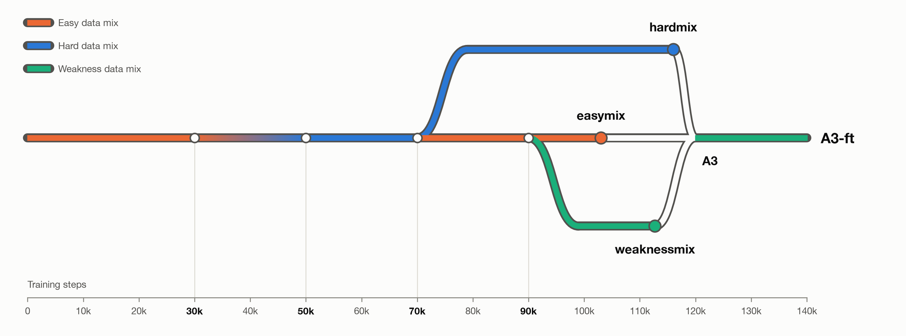

# ARC 2: Weight Averaging for Generalisation

**BLUF: Average your checkpoints and see what happens.**

A 50M-parameter model trained from scratch scores **12.08** on the ARC-AGI-2 public leaderboard and solves 22 of 167 Public Eval queries. It is the fine-tuned weight average of three branches of one training run.

This is a copy of the [Kaggle writeup](https://www.kaggle.com/competitions/arc-prize-2026-paper-track/writeups/new-writeup-1793986007418), with small corrections and a limitations section added.

## Approach

The approach has four parts: a shared model design and pretraining trunk, three continuations on different data regimes, recombination by weight averaging, and test time training on each task. The three continuations trained apart for a third or more of their training, yet their simple weight average had lower validation loss than any of them. After a short fine-tune, the average outscored all three on Public Eval and the leaderboard. This finding suggests avenues for general improvement of existing designs, such as off-policy pretraining and self distillation. The Public Test score for the final model is 12.08.

### Model Design

The model has 50M unique parameters in 16 transformer layers, all looped twice, with 8:4 GQA and a model dimension of 512. Early tests used a 13.8M model with 8 layers of dimension 384. Design choices were ablated on the smaller model and kept when they improved validation loss or solve rate.

### Data Sets

The data comes from public ARC tasks, custom rule generators, and composites of those rules. Every generated rule was filtered against the ARC-AGI-2 eval set to remove overlapping problem logic, preserving that set for scoring the model. 

| Name | Composition | Rules |
| --- | --- | --- |
| ARC | ARC-AGI-2 training (which includes ARC-AGI-1 tasks) and ConceptARC training, one rule per task | 1,010 |
| Generated Composite Rules | Custom rule generators, composites of these rules, and ARC-TGI | 5,018 |
| Eval-Hard | Custom rule generators and their composites selected to be about as difficult as the Public Eval set | 2,127 |
| Failure Modes | Rules written to target common failure patterns of the models | 216 |

About 10% of each data set was held out for validation. The ARC validation set is 100 ARC-AGI-2 training tasks (112 test queries) held out from training. Its loss is the teacher-forced cross-entropy per answer token.

### Pretraining Data Regimes

Each regime mixes the datasets in these percentages:

| Data Regime | ARC | Generated Composite Rules | Eval-Hard | Failure Modes |
| --- | --- | --- | --- | --- |
| easymix | 7 | 93 | 0 | 0 |
| hardmix | 1.5 | 75.6 | 22.9 | 0 |
| weaknessmix | 7 | 61 | 2 | 30 |

From 50k updates, hardmix sampled each generated rule according to its loss at 50k. Rules above the median loss were sampled up to 3× more often (half the rules were upweighted, and 21% reached the cap). The easymix and weaknessmix regimes sampled rules evenly.

### Pretraining

The shared trunk trained for 70k updates. It started on an easy mix with about 30% ARC data, ramped to the hardmix shares between 30k and 40k, and switched fully to hardmix at 50k. At 70k it split into hardmix (best checkpoint at 116k) and easymix (best at 103k). weaknessmix forked from easymix at 90k (final checkpoint at 112.7k). All runs were performed on a single RTX 5090. The three branches did not need to communicate with each other during their individual pretraining.

Each update was 64k tokens. Each update runs the model looped once (33% of updates) or twice (67%).  All checkpoints use EMA weights. Each row is augmented with a random rotation or reflection, a colour permutation, a demonstration swapped in as the query, and shuffled demonstrations. The final model has seen about 12B training tokens, and all training cost for the three source runs and final fine tune were about $18 of rented GPU time.

### Test Time Training

For each test task, all weights are fine-tuned on that task's demonstrations. Each demo example takes a turn as the query, under rotations, reflections and colour permutations drawn from 1,000 total augmentations. Training stops after 120 updates. This number was fixed after Public Eval tests of one hardmix run, which solved 21, 18 and 20 queries at 120, 200 and 300 updates. It is constant at run time. The adapted model decodes the test input under 16 views, maps each candidate back to the original frame, and ranks candidates by their likelihood summed over all 16 views. The top two are submitted as the model's answer.

For the final submission a scheduler predicts each task's time cost, updates the prediction as tasks finish, and falls back to 80, 40, 20 or 0 updates to ensure that all inputs fit in the time limit. The scheduler projected 2.2 of the 11.2 available hours for the hidden test set, so every task likely got the full 120 updates; the actual run time was not recorded. A 120-task Public Eval run costs about 6 GPU-hours on rented 16 GB GPUs.

## Weight Averaging

A3 is the uniform mean of the three branch checkpoints' weights. A3-ft fine-tunes A3 for 20k steps at a learning rate of 3.75e-5 on the weaknessmix data.

| Checkpoint Pair(s) | Cosine Similarity |
| --- | --- |
| hardmix, easymix | .65 |
| hardmix, weaknessmix | .64 |
| easymix, weaknessmix | .77 |
| Drilled rules | mean .06, range .04 - .24 |

The branches share their first 70k updates and stay close in weight space, so their average lands in a low-loss region. I believe that averaging acts as regularisation, cancelling what each branch fit only to its own data mix: A3 has lower validation loss than every branch, and the fine-tune then sharpens it. Averaging may also transfer knowledge between branches: A3-ft solves 3 Public Eval queries that no branch solved.

### Failed Approaches

I first tried to merge the gains of single-rule drills back into the base model. About 1,500 generated training rules were each drilled with a 300 to 400 step fine-tune of a 13.8M checkpoint. 1,096 drilled checkpoints passed, meaning they gained exact solves or halved the held-out loss on their rule.

Averaging the drilled checkpoints kept 4% or less of their gains and raised ARC validation loss by 6 - 27%. Distillation kept about 70% of the gains in a 9-rule test, at a 3% rise in ARC validation loss. Distilling all 1,096 drilled checkpoints, with the top 250 at 10× weight, raised ARC validation loss by 7% and held-out generated-rule loss by 3%. No gains appeared outside the drilled rules.

The low cosine similarity between drills indicates that each drill moves the weights in an unrelated direction. Averaging cancels this problem-specific learning, and the drills share no common movement towards a general logic solution.

## Results

| Checkpoint | ARC val loss | Public Eval solve@2 (of 167) | Public Leaderboard |
| --- | --- | --- | --- |
| hardmix | .0543 | 19 | 10.83 |
| easymix | .0504 | 14 | - |
| weaknessmix | .0571 | 15 | 8.75 |
| A3 | .0468 | 18 | - |
| A3-ft | .0580 | 22 | 12.08 |

Noise is about ±2 Public Eval queries and ±0.4 leaderboard points. The same A3-ft weights scored 11.67 on Kaggle's T4 GPUs. A3-ft solves 3 queries no parent solved and loses 3 that a parent solved. Validation loss does not correlate well with the Public Leaderboard score: across eight submitted models the rank correlation was .05.

| A3-ft inference | Public Eval solve@2 (of 167) |
| --- | --- |
| No test time training | 2 |
| Test time training, one view | 6 |
| + 16-view majority vote | 14 |
| + 16-view summed likelihood | 22 |

## Conclusion

Three branches of one run, trained apart on different data for a third or more of their training, averaged into a model with lower validation loss than any branch. A short fine-tune of that average gave the best Public Eval and leaderboard score. Single-rule drills could not be combined this way, because their weight changes point in unrelated directions. Test time training and multi-view ranking account for most of the final score (2 → 22).

Future work could vary:
- The branch point(s)
- The time spent training apart
- The number of branches
- The number and types of training regimes

## Limitations

- **The fine-tune has no control.** No single branch was given the same 20k-update fine-tune and scored, so part of A3-ft's gain over hardmix (22 vs 19, 12.08 vs 10.83) may come from the extra training and not from the average. A3 without the fine-tune scores 18, level with hardmix within noise.
- **A3's validation-loss advantage does not survive the fine-tune.** The loss rises from .0468 to .0580 over the 20k updates, the highest in the table, while the solve count rises.
- **One seed and one lineage.** The branches also differ in branch point and length, not only in data.

## Links

- **Writeup:** [ARC 2: Weight Averaging for Generalisation](https://www.kaggle.com/competitions/arc-prize-2026-paper-track/writeups/new-writeup-1793986007418) (ARC Prize 2026 Paper Track)
- **Submission notebook:** [arc2-long50m-a3ft-f20000-l4-sub-20261101](https://www.kaggle.com/code/jayachdee/arc2-long50m-a3ft-f20000-l4-sub-20261101)
- **Model:** [ARC-AGI-2 looped transformer](https://www.kaggle.com/models/jayachdee/arc2-looped-transformer)
- **Submission bundle:** [arc2-long50m-a3ft-f20000-l4-bundle](https://www.kaggle.com/datasets/jayachdee/arc2-long50m-a3ft-f20000-l4-bundle)
- **Code and generators:** [arc2-paper-code](https://www.kaggle.com/datasets/jayachdee/arc2-paper-code)
- **Weights:** [arc2-paper-weights](https://www.kaggle.com/datasets/jayachdee/arc2-paper-weights)
- **Training data:** [arc2-paper-training-data](https://www.kaggle.com/datasets/jayachdee/arc2-paper-training-data)
- **Results and figures:** [arc2-paper-results](https://www.kaggle.com/datasets/jayachdee/arc2-paper-results)

The writeup is licensed [CC BY 4.0](https://creativecommons.org/licenses/by/4.0/).
